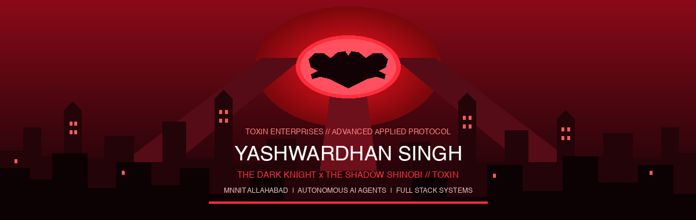

<div align="center">

<!-- RED WAVING HEADER -->


<!-- HERO BANNER: GOTHAM CITY AT NIGHT & THE BAT-SIGNAL (CRIMSON RED EDITION) -->


<br/>

<!-- BATCOMPUTER DYNAMIC TERMINAL PROMPT -->


<br/>

<!-- SURVEILLANCE & ALLIANCE HUD -->
<p align="center">
  
  &nbsp;
  <a href="https://github.com/Yashwardhan61?tab=followers" target="_blank">
    
  </a>
</p>


<br/>

> *"A hero can be anyone. Even a man doing something as simple and reassuring as putting a coat around a young boy's shoulders to let him know that the world hadn't ended."*  
> **— Bruce Wayne | The Dark Knight Rises**

<br/>


</div>

<br/>

<div align="center">

## 01 // CLASSIFIED DOSSIER [BATCOMPUTER ARCHIVE]

*Not every story needs a hero. Some need an architect in the shadows.*

</div>

```yaml
identity:
  name: Yashwardhan Singh
  alias: The Dark Knight // The Shadow Shinobi // ToXiN
  operational_base: Prayagraj, India
  institute: MNNIT Allahabad
  degree: Master of Computer Applications (MCA 2025–2028)

clearance_level: ToXiN Enterprises Level 5 (Applied Sciences)
active_directives:
  - Autonomous AI Agents & Multimodal Orchestration
  - Resilient Backend Infrastructure & Microservices
  - High-Throughput Distributed Architectures

primary_patrols:
  flagship: DocuPilot (Autonomous University Circular Ingestion & Calendar Dispatcher)
  archive: Code Frolics (Cloud Memory & Media Infrastructure)
  terminal: MagicShell (NLP-to-Shell Conversational Execution Core)

creed: "They think I'm hiding in the shadows, but I am the shadows."
```

<div align="center">
  
</div>

<br/>

<div align="center">

## 02 // THE TACTICAL ARSENAL [THE BATCAVE]

*Every warrior needs equipment. Built for speed, precision, and endurance.*

### PRIMARY OFFENSIVE WEAPONS (LANGUAGES)


### HEAVY TACTICAL ENGINES (FRAMEWORKS & RUNTIMES)


### THE SHARINGAN EYE (AI, MULTIMODAL & AGENTS)
<p align="center">
  
  
  
  
</p>

### SECURE CRYPT & STORAGE (DATABASES & CLOUD)


### BATCAVE OPERATIONS & WORKSPACE (DEVOPS & UTILITIES)


<br/>


</div>

<br/>

<div align="center">

## 03 // CLASSIFIED MISSIONS [TACTICAL DEPLOYMENTS]

*Projects built to survive Gotham's harshest tests.*

</div>

<!-- FLAGSHIP HERO CARD: DOCUPILOT -->
<div align="center">
<table width="100%">
<tr>
<td>

### FLAGSHIP OPERATION // DOCUPILOT
**AUTONOMOUS UNIVERSITY NOTICE-TO-ACTION AGENT**

An intelligent multimodal circular ingestion and execution agent for MNNIT Allahabad students. Converts dense administrative circulars and placement notifications into structured deadlines, course-aware student eligibility verdicts, and zero-click calendar reminders.

- **Multimodal AI Extraction**: Direct Google Gemini REST API ingestion for multi-page PDFs, circular images, and plain text with verbatim source evidence.
- **Academic Standing Engine**: Deterministic course duration engine distinguishing Degree Programs (MCA 3y, B.Tech 4y, M.Tech 2y) with dynamic year clamping.
- **Zero-Click Calendar Sync**: Dual synchronization featuring 1-click Google Calendar Web Intent and RFC 5545 `.ics` email dispatch with 12-hour and 3-hour prior reminder alarms.
- **Grounded Notice Q&A**: Contextual question answering backed by circular facts.

`FastAPI` `Google Gemini REST API` `React 18` `Tailwind CSS` `Firebase Auth` `RFC 5545` `pypdf`

<p align="center">
  <a href="https://github.com/Yashwardhan61/DocuPilot" target="_blank">
    
  </a>
  &nbsp;
  <a href="https://drive.google.com/file/d/1_SDS5hW5lJMOVNS8O5hRELwfgoPM5DOa/view?usp=drivesdk" target="_blank">
    
  </a>
</p>

</td>
</tr>
</table>
</div>

<br/>

<!-- 2x2 TACTICAL MISSIONS MATRIX -->
<table>
<tr>
<td width="50%" valign="top">

### 01 // CODE FROLICS
**THE MEMORY ARCHIVE**

Full-stack cloud archive engineered to store and preserve life moments through secure authentication, structured media handling, and optimized asset delivery.

`React` `Spring Boot` `Firebase` `Cloud Deployment`

[ACCESS MISSION →](https://github.com/Yashwardhan61/Code_Frolics)

</td>
<td width="50%" valign="top">

### 02 // MAGICSHELL
**THE COMMAND CENTER**

An AI-powered terminal orchestration interface translating natural language intent into verified command-line operations with safety boundaries.

`Python` `Natural Language Processing` `CLI Engine`

[ACCESS MISSION →](https://github.com/Champhimu/MagicShell)

</td>
</tr>
<tr>
<td width="50%" valign="top">

### 03 // TEAMUPX
**THE ALLIANCE PROTOCOL**

An intelligent team formation engine matching developers and students based on domain competencies, hackathon tracks, schedule availability, and role synergy.

`Spring Boot` `React` `React Native` `Algorithms`

[ACCESS MISSION →](https://github.com/Yashwardhan61/TeamUpX)

</td>
<td width="50%" valign="top">

### 04 // RANGER MED-CORE
**THE GUARDIAN PROJECT**

Healthcare assistance and medication tracking platform featuring capsule regimen management, predictive scheduling, and real-time wellness metrics.

`JavaScript` `AI/ML` `Full Stack Architecture`

[ACCESS MISSION →](https://github.com/Champhimu/ranger-med-core)

</td>
</tr>
</table>

<div align="center">
  <br/>
  
</div>

<br/>

<div align="center">

## 04 // BATCOMPUTER TELEMETRY [GOTHAM PATROL LOGS]

*The signal never rests. Activity recorded in the shadows.*


<br/>

### CHRONICLES OF NIGHT PATROL


<br/>


</div>

<br/>

<div align="center">

## 05 // SECURE COMMS [THE ALLIANCE]

*Encrypted frequencies. Reach out through secure channels.*

<p align="center">
  <a href="https://www.linkedin.com/in/yashwardhan-singh/" target="_blank">
    
  </a>
  &nbsp;
  <a href="https://github.com/Yashwardhan61" target="_blank">
    
  </a>
  &nbsp;
  <a href="mailto:yashwardhan61@gmail.com" target="_blank">
    
  </a>
</p>


<br/>

## 06 // THE FINAL VIGIL


<br/>

> *"They think I'm hiding in the shadows, but I am the shadows."*  
> **— Batman | The Batman (2022)**

<br/>


**THE DARK KNIGHT NEVER SLEEPS.**

</div>
